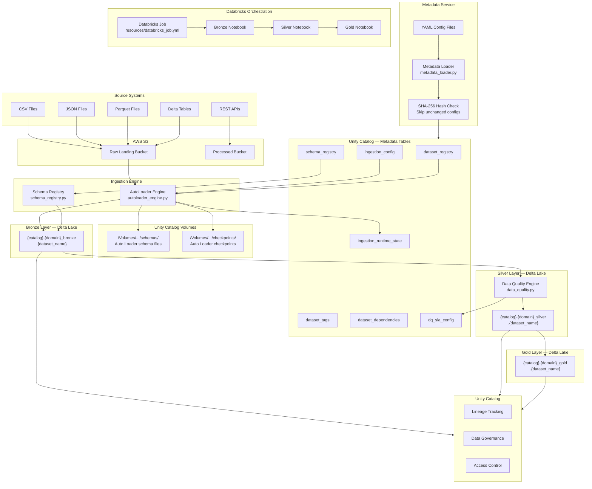

# Architecture — Dynamic Databricks Ingestion Framework

## Overview

The framework is a **metadata-driven ingestion platform** that reads dataset configuration
from Unity Catalog metadata tables and uses that configuration to drive all ingestion
behaviour at runtime. No code changes are required to onboard a new dataset — only a YAML
configuration file and a metadata table row are needed.

---

## Architecture Diagram



---

## Component Descriptions

### Source Systems

The framework supports ingestion from the following source types:

| Source Type | Supported Formats | Ingestion Mode |
|---|---|---|
| File-based (S3) | CSV, JSON, Parquet, Avro | Auto Loader (incremental) or batch overwrite |
| Delta tables | Delta | Batch merge or overwrite |
| REST APIs | JSON response | HTTP pull, configurable pagination |

### AWS S3 — Source Storage

All file-based source data lands in AWS S3 buckets. The framework accesses S3 via:
- **Unity Catalog External Locations** (preferred — governed, no credentials in code)
- **IAM instance profile** attached to the Databricks cluster

S3 paths are configured per dataset in `ingestion_config` and `configs/domain_config.yml`.

### Metadata Service

The metadata service is the entry point of the framework. It:

1. Reads YAML configuration files from `configs/`.
2. Computes a SHA-256 hash of each configuration block.
3. Compares the hash against the existing row in `ingestion_config`.
4. Issues a `MERGE INTO` to Unity Catalog only if the configuration has changed.
5. This prevents unnecessary metadata table writes on every job run.

**Key module:** `ingestion_framework/metadata_service/metadata_loader.py`

### Ingestion Engine

#### Auto Loader (`autoloader_engine.py`)
Databricks Auto Loader (`cloudFiles`) provides scalable, incremental file ingestion:
- Tracks which files have been processed via a checkpoint directory (Unity Catalog Volume).
- Infers or enforces schema, storing the inferred schema in a schema location (Unity Catalog Volume).
- Supports schema evolution with configurable `mergeSchema` and `rescuedDataColumn` options.
- Falls back to batch overwrite for full-load datasets.

#### Schema Registry (`schema_registry.py`)
Manages schema versions in Unity Catalog:
- Registers a new schema version when a schema change is detected.
- Stores schema history in the `schema_registry` metadata table.
- Enables rollback and audit of schema evolution over time.

### Unity Catalog Volumes

Two Unity Catalog Volumes are used as storage locations for Auto Loader internals:

| Volume Path | Purpose |
|---|---|
| `/Volumes/{catalog}/metadata/schemas/` | Auto Loader inferred schema files (JSON) |
| `/Volumes/{catalog}/metadata/checkpoints/` | Auto Loader streaming checkpoints |

These are not Delta tables — they are unstructured file storage within Unity Catalog governance.

### Bronze Layer

- Destination: `{catalog}.{domain}_bronze.{dataset_name}`
- Content: Exact copy of raw source data — no transformations.
- Format: Delta Lake
- Partitioning: Typically by ingestion date (`_ingestion_date`)
- Added metadata columns: `_source_file`, `_ingestion_timestamp`, `_record_hash`
- Load modes: `append` (Auto Loader incremental), `overwrite` (full batch)

### Silver Layer

- Destination: `{catalog}.{domain}_silver.{dataset_name}`
- Content: Cleansed, type-cast, deduplicated, and DQ-validated data.
- Transformations: null handling, type casting, deduplication by primary key + watermark.
- Data Quality: Rules evaluated per `dq_sla_config`; results written back to metadata.
- Load mode: `MERGE INTO` by primary key(s).

### Gold Layer

- Destination: `{catalog}.{domain}_gold.{dataset_name}`
- Content: Business aggregations, joins across Silver tables, KPIs.
- Serves BI tools, dashboards, and ML feature pipelines.
- Respects dataset dependencies defined in `dataset_dependencies`.

### Databricks Job Orchestration

Jobs are defined as YAML resources under `resources/` and deployed via Databricks Asset Bundles.
A typical Bronze ingestion job:
1. Accepts `source_system` and `environment` as parameters.
2. Queries `dataset_registry` + `ingestion_config` to get active datasets.
3. Loops through datasets and calls the ingestion engine per dataset.
4. Writes execution status to `ingestion_runtime_state`.

### Unity Catalog — Governance

Unity Catalog provides:
- **3-level namespace**: `catalog.schema.table`
- **Column-level lineage** (automatic with Delta operations)
- **Access control**: Row and column-level security
- **Data classification**: Tags applied from `dataset_tags`
- **Audit logging**: All data access is logged

### Databricks Asset Bundles (DAB) Deployment

The entire framework is packaged as a Databricks Asset Bundle:
- `databricks.yml` defines the bundle, targets, and variables.
- `resources/*.yml` defines job resources.
- `databricks bundle deploy --target {env}` deploys to the target workspace.
- Environments: `dev`, `uat`, `prod` with separate workspace hosts.

---

## Data Flow Summary

```
1. YAML configs → metadata_loader → MERGE INTO ingestion_config (if changed)
2. Job triggered → reads ingestion_config for active datasets
3. Per dataset: autoloader_engine reads S3 files, writes to Bronze Delta table
4. schema_registry records schema version if schema changed
5. ingestion_runtime_state updated with run metrics (rows, duration, status)
6. Silver job reads Bronze → applies DQ rules → writes to Silver Delta
7. Gold job reads Silver → applies aggregations → writes to Gold Delta
```

---

## Key Design Decisions

| Decision | Rationale |
|---|---|
| SHA-256 hash for metadata deduplication | Avoids unnecessary MERGE writes when config hasn't changed |
| Unity Catalog Volumes for checkpoints | Governed, auditable storage — not unmanaged S3 paths |
| Auto Loader over Spark Structured Streaming directly | Simpler file discovery, built-in checkpointing, schema evolution |
| Separate metadata tables per concern | Avoids a single bloated config table; enables independent evolution |
| DAB for deployment | Reproducible, environment-aware deployment without manual steps |
