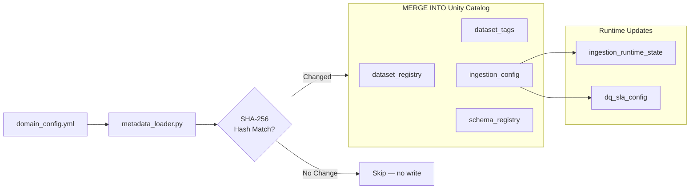

# Metadata Design — Dynamic Databricks Ingestion Framework

## Overview

The framework's behaviour is entirely driven by **seven Unity Catalog metadata tables**,
plus two **Unity Catalog Volumes** for Auto Loader internals. Together these form the
"control plane" of the ingestion platform.

All metadata tables live in a dedicated schema:
```
{catalog}.ingestion_metadata
```

---

## Unity Catalog Volumes

### `/Volumes/{catalog}/metadata/schemas/`

**Purpose:** Auto Loader stores its **inferred schema** for each dataset here as a JSON file.
This prevents schema re-inference on every run and enables schema evolution tracking.

- One subdirectory per dataset: `.../schemas/{dataset_name}/`
- Files are managed automatically by Databricks Auto Loader.
- Do not edit these files manually.
- Governed by Unity Catalog — access is controlled via volume grants.

### `/Volumes/{catalog}/metadata/checkpoints/`

**Purpose:** Auto Loader stores its **streaming checkpoint** for each dataset here.
The checkpoint tracks which files have already been processed, enabling exactly-once incremental ingestion.

- One subdirectory per dataset: `.../checkpoints/{dataset_name}/`
- Files are managed automatically by Databricks Auto Loader.
- Deleting a checkpoint directory forces a full re-scan of all source files.
- Never delete checkpoints in production without a full data reload plan.

---

## Metadata Tables

### 1. `dataset_registry`

**Purpose:** The master registry of all datasets managed by this framework. Each row represents
one logical dataset. This is the authoritative source of dataset identity.

| Column | Type | Description |
|---|---|---|
| `dataset_id` | STRING (UUID) | Unique dataset identifier (primary key) |
| `dataset_name` | STRING | Logical name (e.g., `orders`, `customers`) |
| `version` | STRING | Dataset schema version (e.g., `1.0`, `2.1`) |
| `dataset_type` | STRING | `transactional`, `reference`, `event`, etc. |
| `data_tier` | STRING | `bronze`, `silver`, `gold` |
| `source_system` | STRING | Source system identifier (e.g., `ecommerce`, `erp`) |
| `business_description` | STRING | Human-readable description of the dataset |
| `criticality` | STRING | `high`, `medium`, `low` |
| `classification` | STRING | `internal`, `confidential`, `public` |
| `pii` | BOOLEAN | Whether the dataset contains PII |
| `active` | BOOLEAN | Whether this dataset is enabled for ingestion |
| `created_at` | TIMESTAMP | Row creation timestamp |
| `updated_at` | TIMESTAMP | Last update timestamp |
| `created_by` | STRING | User/service principal that created the row |

> **TODO:** Confirm whether `dataset_id` is generated by the framework or provided externally.
> See `docs/open_questions.md` — OQ-001.

---

### 2. `dataset_tags`

**Purpose:** Key-value tag store for datasets. Supports flexible classification, searchability,
and downstream governance policies (e.g., PII masking, retention).

| Column | Type | Description |
|---|---|---|
| `dataset_id` | STRING | Foreign key → `dataset_registry.dataset_id` |
| `tag_key` | STRING | Tag name (e.g., `domain`, `owner`, `retention_days`) |
| `tag_value` | STRING | Tag value (e.g., `finance`, `data-team`, `90`) |
| `created_at` | TIMESTAMP | Row creation timestamp |

> **TODO:** Confirm whether tags are flat key-value or support nested structure.
> See `docs/open_questions.md` — OQ-002.

---

### 3. `dataset_dependencies`

**Purpose:** Tracks upstream/downstream relationships between datasets. Used by the Gold layer
to determine execution order and ensure upstream Silver datasets are ready before Gold runs.

| Column | Type | Description |
|---|---|---|
| `dependency_id` | STRING (UUID) | Unique dependency identifier |
| `upstream_dataset_id` | STRING | FK → `dataset_registry.dataset_id` |
| `downstream_dataset_id` | STRING | FK → `dataset_registry.dataset_id` |
| `dependency_type` | STRING | `hard` (must complete) or `soft` (best-effort) |
| `created_at` | TIMESTAMP | Row creation timestamp |

> **TODO:** Confirm whether dependency resolution is handled in-framework or by Databricks Workflows task dependencies.
> See `docs/open_questions.md` — OQ-003.

---

### 4. `ingestion_config`

**Purpose:** The primary ingestion configuration table. Contains all parameters needed to
ingest a dataset: source location, format, load mode, schema/checkpoint paths, primary keys,
watermark, and DQ settings. One row per dataset.

| Column | Type | Description |
|---|---|---|
| `config_id` | STRING (UUID) | Unique config identifier |
| `dataset_id` | STRING | FK → `dataset_registry.dataset_id` |
| `environment` | STRING | `dev`, `uat`, `prod` |
| `ingestion_mode` | STRING | `auto_loader` or `batch` |
| `load_type` | STRING | `incremental` or `full` |
| `s3_bucket` | STRING | Source S3 bucket name |
| `s3_path` | STRING | Prefix/path within the bucket |
| `file_pattern` | STRING | Optional file glob (e.g., `*.csv`, `orders_*.json`) |
| `format` | STRING | `csv`, `json`, `parquet`, `delta`, `avro` |
| `delimiter` | STRING | Field delimiter for CSV (default `,`) |
| `encoding` | STRING | File encoding (default `UTF-8`) |
| `header` | BOOLEAN | Whether CSV has a header row |
| `multiline` | BOOLEAN | Whether JSON is multi-line |
| `schema_location` | STRING | Unity Catalog volume path for Auto Loader schema |
| `checkpoint_location` | STRING | Unity Catalog volume path for Auto Loader checkpoint |
| `primary_keys` | ARRAY<STRING> | Primary key columns for MERGE / deduplication |
| `watermark_column` | STRING | Timestamp column for incremental filtering |
| `watermark_delay` | STRING | Late data tolerance (e.g., `2 hours`) |
| `frequency` | STRING | `daily`, `hourly`, `weekly`, `on_demand` |
| `target_table` | STRING | Fully qualified target table name |
| `config_hash` | STRING | SHA-256 hash of this config row (deduplication) |
| `created_at` | TIMESTAMP | Row creation timestamp |
| `updated_at` | TIMESTAMP | Last update timestamp |

> **TODO:** Confirm the full list of reader options that can be specified (e.g., `dateFormat`, `timestampFormat`).
> See `docs/open_questions.md` — OQ-004.

---

### 5. `ingestion_runtime_state`

**Purpose:** Per-run execution tracking. Every ingestion run writes a row here with metrics,
status, and timing. Enables monitoring, alerting, and debugging.

| Column | Type | Description |
|---|---|---|
| `run_id` | STRING | Databricks job run ID |
| `dataset_id` | STRING | FK → `dataset_registry.dataset_id` |
| `environment` | STRING | `dev`, `uat`, `prod` |
| `layer` | STRING | `bronze`, `silver`, `gold` |
| `start_time` | TIMESTAMP | Run start time |
| `end_time` | TIMESTAMP | Run end time |
| `duration_seconds` | LONG | Elapsed seconds |
| `status` | STRING | `RUNNING`, `SUCCESS`, `FAILED`, `SKIPPED` |
| `rows_ingested` | LONG | Number of rows written in this run |
| `rows_failed_dq` | LONG | Number of rows that failed DQ checks |
| `source_file_count` | LONG | Number of source files processed |
| `error_message` | STRING | Error details if status = FAILED |
| `created_at` | TIMESTAMP | Row insertion timestamp |

> **TODO:** Confirm whether this table uses MERGE (upsert by run_id) or INSERT ONLY (append).
> See `docs/open_questions.md` — OQ-005.

---

### 6. `dq_sla_config`

**Purpose:** Data quality rule definitions and SLA thresholds per dataset. The DQ engine
reads rules from this table, evaluates them against Silver data, and writes results back.

| Column | Type | Description |
|---|---|---|
| `dq_rule_id` | STRING (UUID) | Unique rule identifier |
| `dataset_id` | STRING | FK → `dataset_registry.dataset_id` |
| `rule_name` | STRING | Human-readable rule name |
| `rule_type` | STRING | `not_null`, `unique`, `range`, `regex`, `referential` |
| `column_name` | STRING | Target column for the rule |
| `rule_expression` | STRING | Rule definition (e.g., `value > 0`, `[A-Z]{2}`) |
| `threshold_pct` | DECIMAL | % of rows that must pass (e.g., `99.5`) |
| `fail_on_breach` | BOOLEAN | Whether to abort write if threshold breached |
| `sla_type` | STRING | `completeness`, `freshness`, `accuracy`, `timeliness` |
| `sla_deadline` | STRING | SLA time (e.g., `08:00 UTC`) — TODO: confirm format |
| `last_run_pass_pct` | DECIMAL | Pass % from last execution |
| `last_run_at` | TIMESTAMP | Timestamp of last DQ evaluation |
| `active` | BOOLEAN | Whether this rule is currently active |
| `created_at` | TIMESTAMP | Row creation timestamp |

> **TODO:** Confirm DQ result storage — is `last_run_pass_pct` updated in-place, or is there a
> separate `dq_results` history table?  See `docs/open_questions.md` — OQ-006.

---

### 7. `schema_registry`

**Purpose:** Versioned history of schema changes per dataset. The framework writes a new row
whenever the inferred or declared schema changes, enabling schema evolution audit and rollback.

| Column | Type | Description |
|---|---|---|
| `schema_version_id` | STRING (UUID) | Unique version identifier |
| `dataset_id` | STRING | FK → `dataset_registry.dataset_id` |
| `version_number` | INTEGER | Incrementing version (1, 2, 3, …) |
| `schema_json` | STRING | Full schema serialised as JSON string |
| `change_type` | STRING | `initial`, `add_column`, `rename_column`, `type_change`, `drop_column` |
| `changed_columns` | ARRAY<STRING> | Columns added/removed/changed in this version |
| `is_current` | BOOLEAN | Whether this is the active schema version |
| `registered_at` | TIMESTAMP | When this version was registered |
| `registered_by` | STRING | Service principal or user |

> **TODO:** Confirm whether `schema_json` stores a Spark StructType JSON or a custom format.
> See `docs/open_questions.md` — OQ-007.

---

## Metadata Flow Diagram



---

## Governance Notes

- All metadata tables are **Unity Catalog managed tables** — they benefit from lineage, access control, and audit logging automatically.
- The `ingestion_metadata` schema should have **restricted write access**: only the ingestion service principal can write; data engineers can read.
- The `dq_sla_config` table should be **readable by data stewards** for SLA monitoring.
- `ingestion_runtime_state` should be retained for at least 90 days for audit purposes.
