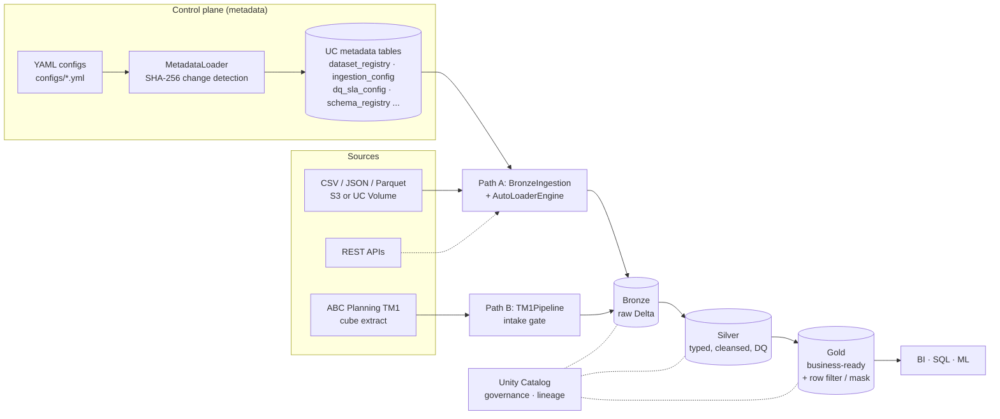
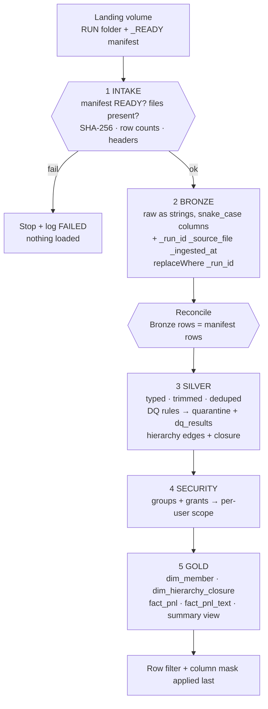
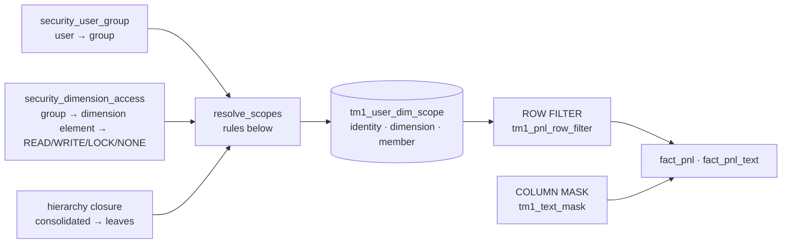
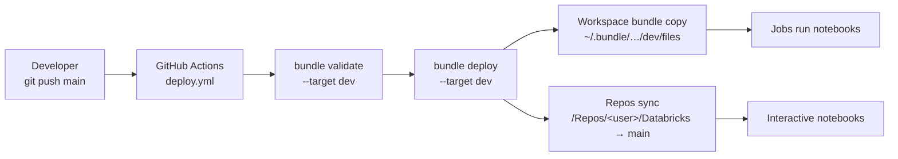

# Project Flow & Ingestion Framework — How It Works

**Project:** Dynamic Databricks Ingestion Framework (Blumetra)
**Audience:** data engineers and new team members
**Companion docs:** [architecture](architecture.md) · [metadata design](metadata_design.md) ·
[TM1 pipeline & security](tm1_pipeline.md) · [deployment guide](deployment_guide.md)

---

## 1. What this project is

A **metadata-driven ingestion framework** on Databricks (Delta Lake + Unity Catalog).
Instead of writing a Spark job per dataset, you describe a dataset in a YAML file; a single
parameterised engine reads that description and ingests the data into a Bronze → Silver → Gold
medallion architecture.

The project contains **two ingestion paths** that share the same platform conventions:

| Path | Source | Style | Status |
|---|---|---|---|
| **A. Generic framework** | CSV / JSON / Parquet / Delta / API files, any dataset | YAML → metadata tables → Auto Loader / batch | Bronze implemented; Silver/Gold are scaffolds (`TODO Phase 2/3`) |
| **B. ABC Planning (TM1) P&L pipeline** | Planning-cube extract: fact, dimensions, hierarchies, security | Manifest-gated run → Bronze → Silver → security → Gold | Written end to end; **Bronze being validated on Databricks**, later stages not yet run on a workspace |

---

## 2. The big picture



---

## 3. Repository map

```
dynamic-databricks-ingestion/
├── configs/                     YAML: domain_config, api_config, environments/{dev,uat,prod}
├── sql/metadata_tables.sql      DDL for the 7 metadata tables
├── ingestion_framework/         Reusable core (never imports from src/)
│   ├── metadata_service/        MetadataLoader  (YAML → metadata tables)
│   ├── ingestion_engine/        AutoLoaderEngine, SchemaRegistry
│   └── tm1/                     manifest · hierarchy · security · pipeline  (Path B)
├── src/                         Layer orchestration
│   ├── bronze/                  BronzeIngestion, BronzeLoader, data_extraction
│   ├── silver/                  SilverTransformer, DataQualityEngine   (scaffold)
│   ├── gold/                    Gold transformations                   (scaffold)
│   └── api/                     REST API fetcher
├── notebooks/                   Thin Databricks entry points (bronze/silver/gold + tm1_pnl_pipeline_notebook)
├── resources/                   Asset-bundle jobs (databricks_job.yml, tm1_pnl_job.yml)
├── databricks.yml               Bundle: variables + dev / uat / prod targets
├── .github/workflows/deploy.yml CI/CD: push to main → deploy + Repos sync
├── demo/                        Demo notebook, sample TSVs
└── docs/                        This documentation
```

Design rule: **notebooks are thin** (widgets → call a class); logic lives in importable modules;
`ingestion_framework/` is platform code, `src/` is layer/domain code.

---

## 4. Path A — the generic metadata-driven framework

### 4.1 End-to-end flow

```mermaid
sequenceDiagram
    autonumber
    actor Dev as Data engineer
    participant Y as YAML config
    participant ML as MetadataLoader
    participant MT as Metadata tables (UC)
    participant BI as BronzeIngestion
    participant AL as AutoLoaderEngine
    participant SR as SchemaRegistry
    participant BR as Bronze Delta table

    Dev->>Y: add / edit a dataset block
    Dev->>ML: run (job task: register_metadata)
    ML->>ML: validate required fields, compute SHA-256 of the config
    ML->>MT: compare with stored hash; unchanged → skip
    ML->>MT: changed/new → MERGE registry, tags, ingestion_config, dq rules
    Dev->>BI: run (job task: run_bronze_ingestion)
    BI->>MT: query active datasets (registry JOIN ingestion_config)
    loop each dataset
      BI->>AL: ingest(dataset_config)
      AL->>BR: Auto Loader (incremental) or batch overwrite (full)
      BI->>SR: check_and_register(schema)  (via BronzeLoader)
      BI->>MT: write ingestion_runtime_state (status, rows, duration)
    end
```

### 4.2 Components

| Component | File | Responsibility |
|---|---|---|
| **MetadataLoader** | `ingestion_framework/metadata_service/metadata_loader.py` | Reads YAML, validates, hashes (SHA-256), and MERGEs into `dataset_registry`, `dataset_tags`, `ingestion_config`, `dq_sla_config`. Unchanged configs are skipped. `dataset_id` is a deterministic UUID from `source_system + dataset_name`, so re-registration is idempotent across environments. |
| **BronzeIngestion** | `src/bronze/bronze_ingestion.py` | Entry point for a run. Loads the environment config, selects active datasets (all, or one by name), runs each through `BronzeLoader`, records results in `ingestion_runtime_state`. Never lets one dataset's failure stop the others. Run modes: `incremental`, `full`, `metadata_only`. |
| **AutoLoaderEngine** | `ingestion_framework/ingestion_engine/autoloader_engine.py` | Chooses the reader from `format` (csv, json, parquet, avro, delta, tsv) and the path from `source_type` (volume, s3, dbfs, abfss). `load_type = incremental` → Databricks **Auto Loader** (`cloudFiles`, checkpointed); `load_type = full` → batch overwrite. Adds `_source_file`, `_ingestion_date`, `_ingestion_timestamp`. Returns `{status, rows_ingested, ...}`. |
| **SchemaRegistry** | `ingestion_framework/ingestion_engine/schema_registry.py` | Compares a table's schema with the latest registered version; on change it registers a new version (`add_column`, `drop_column`, `type_change`, `mixed`) and flips `is_current`. |
| **Silver / DQ** | `src/silver/` | Scaffold with documented TODOs: type casts, null handling, dedup, MERGE, rule types (`not_null`, `unique`, `range`, `regex`, `referential`), quarantine. |
| **Gold** | `src/gold/` | Scaffold: aggregations/joins for BI. |

### 4.3 Metadata tables (`sql/metadata_tables.sql`)

| Table | Purpose |
|---|---|
| `dataset_registry` | Identity, owner, classification, criticality, active flag |
| `dataset_tags` | Flat key/value tags |
| `dataset_dependencies` | Dataset-to-dataset dependency graph |
| `ingestion_config` | How to ingest: source type/path, format, load type, delimiter, schema mode, watermark, target table |
| `ingestion_runtime_state` | Per-run status, rows, duration, errors, last run time |
| `dq_sla_config` | DQ rules and SLA thresholds |
| `schema_registry` | Versioned schemas per dataset |

### 4.4 Onboarding a new dataset (the point of the framework)

1. Add a block to `configs/domain_config.yml` (`dataset_name`, `format`, `ingestion_mode`,
   `load_type`, source location, `primary_keys`, DQ rules ...).
2. Run the job. `register_metadata` loads the block; `run_bronze_ingestion` ingests it.
3. No Spark code changes. Edit the YAML again later → the hash changes → metadata is updated.

### 4.5 Job (`resources/databricks_job.yml`)

`register_metadata` (run mode `metadata_only`, retries 2) → `run_bronze_ingestion`
(retries 1, 3 h timeout). Silver and Gold tasks are present as commented placeholders.
Compute is serverless. Parameters (`environment`, `catalog_name`, `metadata_schema`,
`source_system`, `run_mode`, `dataset_name`, `log_level`) come from bundle variables per target.

---

## 5. Path B — ABC Planning (TM1) P&L pipeline

Planning-cube data does not fit "one file = one table": a run is a **set of related files**
(fact + dimensions + hierarchies + security) that must be consistent with each other. So Path B
adds a **manifest gate** and dedicated Silver/Gold logic. Details: [tm1_pipeline.md](tm1_pipeline.md).

### 5.1 Landing contract

The extract writes a run folder to a UC Volume — data files first, `_READY_<RUN>.json` **last**:

```
/Volumes/<catalog>/tm1_landing/landing/RUN001/
   profit_and_loss_data_RUN001.tsv          (fact, ~27k rows)
   dimension_members_RUN001.tsv   dimension_attribute_RUN001.tsv   dimension_alias_RUN001.tsv
   dimension_primary_hierarchy_RUN001.json  dimension_alternate_hierarchy_RUN001.json
   security_user_group_RUN001.tsv           security_dimension_access_RUN001.tsv
   _READY_RUN001.json                       (manifest: checksums, row counts, columns)
```

The notebook finds the run folder by searching for the manifest, so a nested upload still works.

### 5.2 Stages



| Stage | What happens | Key tables |
|---|---|---|
| **Intake** | `validate_run()` checks status = READY, `file_count`, each file's existence, size, SHA-256, row count and header; total rows. Any error aborts before loading. | `tm1_run_log` |
| **Bronze** | Reads each TSV with Spark (all strings, quote handling off because values contain bare `"`), renames columns to `snake_case` (Delta-safe), stamps lineage columns, writes with `replaceWhere _run_id = '<RUN>'` — **re-running a run is idempotent and history of all runs is kept**. Hierarchy JSON is flattened in Python into edge rows. `verify_bronze()` reconciles counts against the manifest and fails on mismatch. | `tm1_bronze.bronze_*` |
| **Silver** | Casts types (decimal(28,4), timestamps, booleans), trims, de-duplicates on the 9-dimension natural key keeping the latest `last_updated_at`. DQ: *error* rules (keys not null, value type valid, numeric/string value present, time period format, known version) send rows to `silver_pnl_fact_quarantine` and fail the run above `dq_max_fail_pct` (5%); *warn* rules (member is a valid leaf, e.g. orphans such as `UNMAPPED`) are only counted. Builds hierarchy edges + closure; types the security files and flags `is_effective`. | `tm1_silver.*`, `tm1_dq_results` |
| **Security** | Resolves group grants to a flat per-user scope (rules in §6). | `tm1_user_dim_scope` |
| **Gold** | Conformed `dim_member` (attributes/aliases as maps), hierarchy closure, `fact_pnl` (numeric: Amount, Headcount), `fact_pnl_text` (Comment, Approval Status ...), `vw_pnl_version_summary` (Actual vs Budget vs Forecast). Drops policies, rebuilds, re-applies policies last. | `tm1_gold.*` |

### 5.3 Why it is built this way

* **Manifest gate** → partial or corrupted extracts never reach Bronze.
* **Snake-case Bronze + all strings** → Bronze never fails on bad data; typing problems surface in Silver DQ where they can be quarantined.
* **`replaceWhere` per run** → safe retries; full lineage of every run.
* **Serverless-safe** → no `cache()`/`persist()`, no RDD/DBFS APIs.
* **Pure-Python cores** (`manifest`, `hierarchy`, `security`) → unit-testable without Spark.

---

## 6. Security model (Path B)

TM1 exports who may see what; Databricks enforces it with Unity Catalog row filters and column masks.



**Resolution rules** (`ingestion_framework/tm1/security.py`):

1. Inactive users get no access.
2. A grant is effective when `Granted_Date <= today` and it has not expired.
3. `READ`/`WRITE`/`LOCK` grant visibility (LOCK = read-only); `NONE` is an explicit denial.
4. Grants on consolidated/root elements (or `Applies_To_Descendants = Y`) expand to all leaves below them, across primary and alternate hierarchies.
5. Per user and dimension: positive grants → `allowed = positives − denied`; only denials → all leaves minus denied; nothing → dimension is open (`*`). **NONE always wins.** A user's groups are unioned.
6. A user with no effective grant at all is denied everywhere (fail closed).

A fact row is visible only if it passes **every** secured dimension (Currency, Legal Entity,
Department, Molecule, Profit and Loss Account, Version, Time Period). Members of `tm1_admins`
bypass the filter; `tm1_text_readers` (and admins) see unmasked comment text.
Identity = `lower(coalesce(email, username))` matched with `lower(current_user())`.

---

## 7. Environments & deployment (CI/CD)



* **Targets** (`databricks.yml`): `dev` (mode development, host configured, catalog `workspace`),
  `uat` (staging) and `prod` (production) — UAT/prod hosts and buckets are still placeholders.
* **Push to `main`** → validate → deploy to **dev** → update the Databricks Repo to `main`.
  Manual runs (`workflow_dispatch`) can pick dev / uat / prod. Pull requests only validate.
* **Secrets required:** `DATABRICKS_HOST`, `DATABRICKS_TOKEN`, `DATABRICKS_USER_EMAIL`.
* ⚠ The Repo update **discards uncommitted edits** made in Databricks — commit/push from the Repos UI first.
* Notebook edits in Databricks reach Git only via **Commit & Push** in the Repos Git dialog; the
  bundle copy (`~/.bundle/...`) is deploy-only and is overwritten on each deploy.

---

## 8. How to run

**Path A (generic):** `databricks bundle deploy -t dev` → `databricks bundle run bronze_ingestion_job -t dev`.

**Path B (TM1), interactively** — notebook `notebooks/tm1_pnl_pipeline_notebook` on serverless:

1. `stage = stage_landing` (creates `<catalog>.tm1_landing.landing` volume).
2. Upload the run's 9 files into the volume folder `RUN001` (Catalog → volume → Upload).
3. `stage = through_bronze` → intake + Bronze + reconciliation (expected counts: fact 27,347 ·
   members 250 · attributes 418 · aliases 141 · user_group 54 · dimension_access 78 ·
   hierarchies 6 primary + 4 alternate).
4. `stage = all` for Silver, security and Gold.

**Path B as a job:** `databricks bundle run tm1_pnl_job -t dev`
(stage_landing → intake → bronze → silver → security → gold). For production, enable the
commented `file_arrival` trigger on the landing volume.

**Check access:** `pipe.preview_access("user@blumetra.com")` returns visible vs total rows for any identity.

---

## 9. Observability

| Where | What |
|---|---|
| `ingestion_runtime_state` | Path A: per dataset per run — status, rows, duration, error |
| `tm1_run_log` | Path B: per stage per run — OK / FAILED / BREACH, row count, message |
| `tm1_dq_results` | Path B: per rule — failed rows, %, threshold, breached |
| `silver_pnl_fact_quarantine` | Rows rejected by error rules, with the failed rule names |
| Unity Catalog | Lineage, audit logs, grants |

---

## 10. Current status & known limits

* **Path A:** metadata loading and Bronze are implemented; Silver/DQ/Gold modules are scaffolds
  with documented TODOs. Auto Loader needs UC Volume/S3 sources configured per environment.
* **Path B:** pure-Python modules are unit-tested (manifest, hierarchy, security). The Spark pipeline
  has been syntax-checked only; **Bronze is the first stage being run on Databricks**, Silver /
  security / Gold have not yet been run on a workspace.
* Cube extracts are treated as **full snapshots** — Silver/Gold reflect the latest run; Bronze keeps all runs.
  Delta extracts (`previous_run_id`) are not modelled yet.
* `WRITE`/`LOCK` have no Databricks equivalent; row filters control visibility only.
* No currency conversion (no FX-rate data in the extract). `Adj-<year>` periods keep `period_start = NULL`.
* UAT/prod workspace hosts, buckets and approval gates are not configured yet.
* Test coverage is limited to `MetadataLoader` and the three TM1 pure-Python modules.

---

## 11. Glossary

| Term | Meaning |
|---|---|
| **Medallion** | Bronze (raw) → Silver (clean) → Gold (business-ready) layering |
| **Auto Loader** | Databricks incremental file ingestion (`cloudFiles`) with checkpointing |
| **Unity Catalog (UC)** | Databricks governance layer: catalogs, schemas, volumes, grants, lineage |
| **DAB** | Databricks Asset Bundle — deploys jobs/files from `databricks.yml` |
| **Manifest / `_READY` file** | JSON written last by an extract, describing every file in the run |
| **Closure table** | (ancestor, member, distance) rows that make hierarchy roll-ups simple joins |
| **Row filter / column mask** | UC functions that hide rows or mask values per querying user |
| **Leaf / consolidated** | Lowest-level members vs members that roll up other members |
| **TM1 / ABC Planning** | The planning system whose P&L cube is the Path B source |
